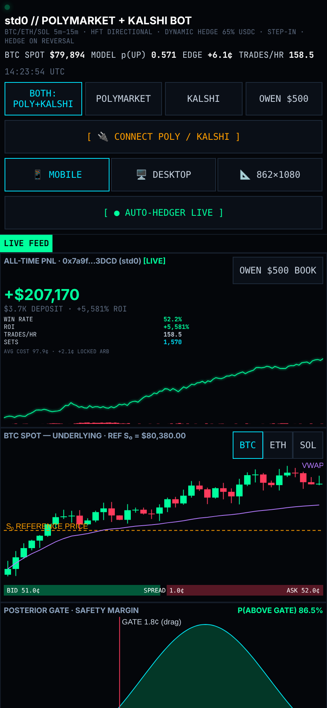

# std0 // Polymarket & Kalshi Repricing Desk

A live, installable (PWA) trading desk that hunts **mispricing** on Polymarket and Kalshi crypto Up/Down markets (BTC / ETH / SOL, 5m–15m) and binary event markets.

**Live app:** https://owenpkemp-hub.github.io/std0-polymarket-kalshi-bot/



## How it works

1. **S₀ reference price.** Each Up/Down window opens at a strike `S₀` (the spot price at window start). The market resolves **UP** if spot `S_T ≥ S₀` at expiry. Tap any candle on the spot chart to reset `S₀`.
2. **`p_model` vs market price.** Live spot `S_t` streams from Coinbase (`wss://ws-feed.exchange.coinbase.com`) and Binance (`wss://stream.binance.com:9443/ws/btcusdt@trade`, plus ETH/SOL). With time left `τ` and short-horizon volatility `σ`, the engine estimates
   `p_model = Φ( ln(S_t/S₀) / (σ·√τ) )`.
   **Edge = p_model − market ask.** A trade fires only when edge clears spread + fees + your **edge gate** (default 1.8¢, adjustable/draggable, saved on device).
3. **Dynamic hedging: Up → Down → Up → Down.** Step in on the side the model favours (`STEP-IN BUY UP`). When price reverses, buy the other side cheaply (`HEDGE BUY DOWN`). Repeating this on each swing accumulates both sides.
4. **Complete-set arbitrage (< $1.00).** One UP + one DOWN share always pays exactly **$1.00** at settlement. If your combined average cost is below $1.00 (e.g. 97.9¢), `LOCK COMPLETE SET` locks the gap (+2.1¢/pair) risk-free; only the leftover residual is directional. `SETTLE` resolves the window. `AUTO-REPRICE SCAN` lists markets whose UP+DOWN asks sum below `$1 − gate`.

The desk pulls live markets in the browser from
`https://gamma-api.polymarket.com/events?active=true&closed=false&limit=30` and
`https://api.elections.kalshi.com/trade-api/v2/markets?status=open&limit=30`.
If a venue blocks browser calls (Kalshi does not send CORS headers), it falls back to the bundled `live_markets.json` snapshot automatically.

All buttons in the browser run in **paper mode**. Real order signing happens only in the Python engine with your keys.

## Install on your Home Screen (2 taps)

- **iPhone / iPad (Safari):** open the live URL → **Share** → **Add to Home Screen**.
- **Android (Chrome):** open the live URL → **⋮** → **Install app** / **Add to Home screen**.
- **Desktop (Chrome/Edge):** click the install icon in the address bar.

It launches full-screen, offline-capable (service worker caches the app shell), and remembers your bankroll mode ($500 vs $207,170), trade history, open positions, complete sets, edge gate, view mode, and saved API credentials in `localStorage` on that device.
Views: **📱 MOBILE / 🖥️ DESKTOP / 📐 862×1080**. Phones (< 768px) pick mobile on their own.

## Run the engine locally

```bash
python3 repricing_engine.py --once        # fetch a live snapshot → live_markets.json
python3 repricing_engine.py --serve       # JSON API on http://localhost:8787
python3 -m http.server 8000               # then open http://localhost:8000
```

## Connect Polymarket & Kalshi API keys

Tap **CONNECT POLY / KALSHI** and enter your Polymarket CLOB API key / secret / wallet address and your Kalshi API key ID and private key (PEM). They are stored **only on your device** (`localStorage`) and never get committed or sent anywhere by the web app. Right now `repricing_engine.py` reads only public data (Gamma, CLOB, Kalshi Trade API v2, Coinbase/Binance) and runs in **PAPER_SIM** mode. It reads `POLY_API_KEY`, `POLY_SECRET`, `POLY_PASSPHRASE`, `POLY_WALLET`, `KALSHI_API_KEY_ID`, `KALSHI_PRIVATE_KEY` from the environment to report connection status. To place real orders you have to add authenticated order signing with the official `py-clob-client` (Polymarket) and Kalshi's RSA-signed REST API. Start in paper mode and size small. This is a tool and does not promise a profit.
